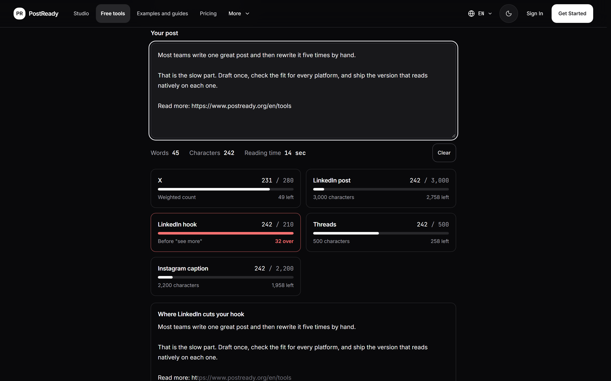
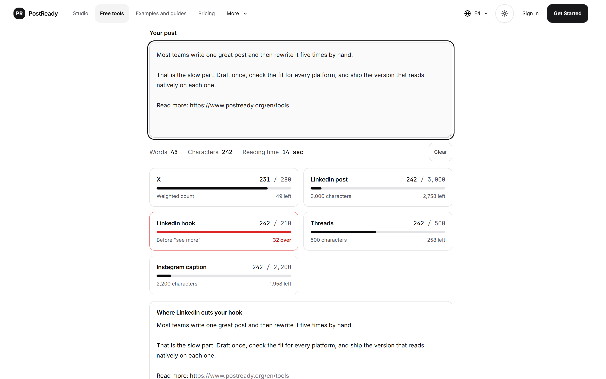

# PostReady design language

The visual system behind [postready.org](https://www.postready.org/en). Tokens are in [`design/tokens.css`](design/tokens.css).

## North star: an editorial studio

PostReady is a place to write, check and ship posts. It pairs the precision of a code editor (monospace counts, status pills, exact limits) with the clarity of good editorial design (high contrast, crisp type, clean structure). The interface stays quiet so the writing is the loudest thing on screen.

- **Dark first, light equal.** Dark (`#09090b` canvas, `#18181b` cards) is the default; the light theme gets the same contrast and the same care.
- **Two typefaces, two jobs.** Inter for reading, JetBrains Mono for anything you count: characters, limits, word totals, labels.
- **Structure from hairlines.** 1px borders frame cards and panels. Depth comes from tone, not from shadows.
- **Colour means something.** Neutrals carry the layout. Colour appears only when it tells you something.

<table>
  <tr>
    <td width="50%"></td>
    <td width="50%"></td>
  </tr>
</table>

## Colour

| Role | Light | Dark | Use |
| --- | --- | --- | --- |
| Canvas | `#ffffff` | `#09090b` | Page background |
| Card | `#ffffff` | `#18181b` | Cards, previews, panels |
| Muted surface | `#f4f4f5` | `#27272a` | Inputs, hover states, quiet controls |
| Hairline | `#e4e4e7` | `#27272a` | Every structural border |
| Text | `#09090b` | `#fafafa` | Body copy and primary buttons |
| Secondary text | `#55555e` | `#a1a1aa` | Descriptions, helper text |

Signal colours, used only for state:

| Signal | Value | Means |
| --- | --- | --- |
| Emerald | `#10b981` | Copied, ready, within the limit |
| Red | `#f87171` | Over a platform limit |
| Amber | `#fcd34d` | Worth a second look |
| Cyan | `#22d3ee` | Summary output |
| Violet | `#8b5cf6` | Threads output |

Each platform output carries its own tint on its badge (X, LinkedIn, Newsletter, Threads, Summary), and nowhere else.

## Typography

| Style | Font | Size / line height | Use |
| --- | --- | --- | --- |
| Display | Inter 700, tracking -0.02em | 36px / 1.2 | Page and hero headings |
| Headline | Inter 600, tracking -0.01em | 24px / 1.3 | Section and card titles |
| Title | Inter 600 | 18px / 1.4 | Tool names, preview headers |
| Body | Inter 400 | 14px / 1.5 | Copy, instructions, outputs |
| Mono | JetBrains Mono 500 | 13px / 1.5 | Counts, limits, totals |
| Micro | JetBrains Mono 600, tracking 0.02em | 11px / 1.3 | Badges and tags |

Numbers that change as you type are always monospace, so they never shift the layout.

## Space, shape and depth

- **Grid:** 4px base, with 8, 16, 24 and 32px steps. Toolbars and navigation stay dense (8 to 12px gaps); cards breathe (16 to 20px padding).
- **Radius:** 6, 8, 10, 12 and 16px. Buttons and inputs use 12px, cards 16px, and pills are fully rounded.
- **Depth:** level 0 is the flat canvas, level 1 a card with a hairline border, level 2 a dialog over a blurred, dimmed backdrop. No coloured or diffuse shadows.
- **Layout:** stacked on phones and tablets, side by side on desktop, so the source and its previews sit next to each other.

## Components

- **Primary button:** solid, high-contrast (black on light, white on dark), 12px radius, bold label.
- **Secondary button:** muted surface with a hairline border.
- **Platform preview:** a card with the platform's header and badge, a live monospace counter that turns red past the limit, inline editing and a one-click copy with a check-mark confirmation.
- **Limit meter:** a thin bar under each platform's count; neutral while within the limit, red once over it, with "N left" or "N over" in plain words.
- **Checks list:** one row per check with an icon, a one-word status (OK, Check) and a plain sentence explaining why.

## Motion

- **150ms** for hover, tab changes and the copy confirmation.
- **200ms** for dialogs and drawers.
- Easing: `cubic-bezier(0.16, 1, 0.3, 1)`.
- Motion explains something (a source branching into five outputs, an output lighting up when it arrives). It never runs only to decorate, and it respects `prefers-reduced-motion`.

## What PostReady avoids

- Heavy drop shadows, coloured glows and drifting background blobs.
- Decorative gradients behind text.
- Previews that do not look like the real platform.
- Meta-commentary in outputs: no "here is your post", stage directions or placeholders. Every output is ready to paste.
- Animations that make you wait.
