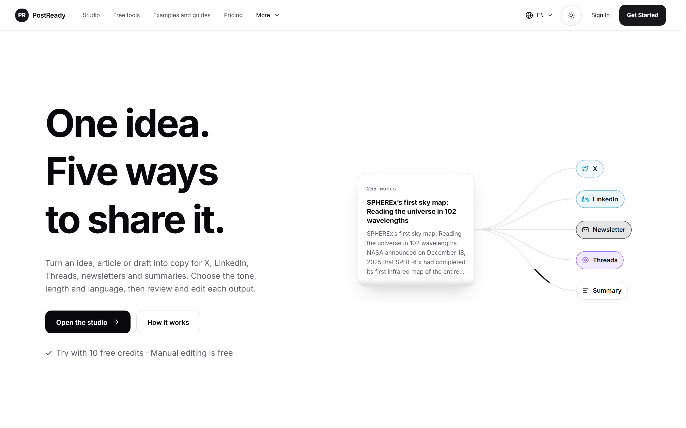
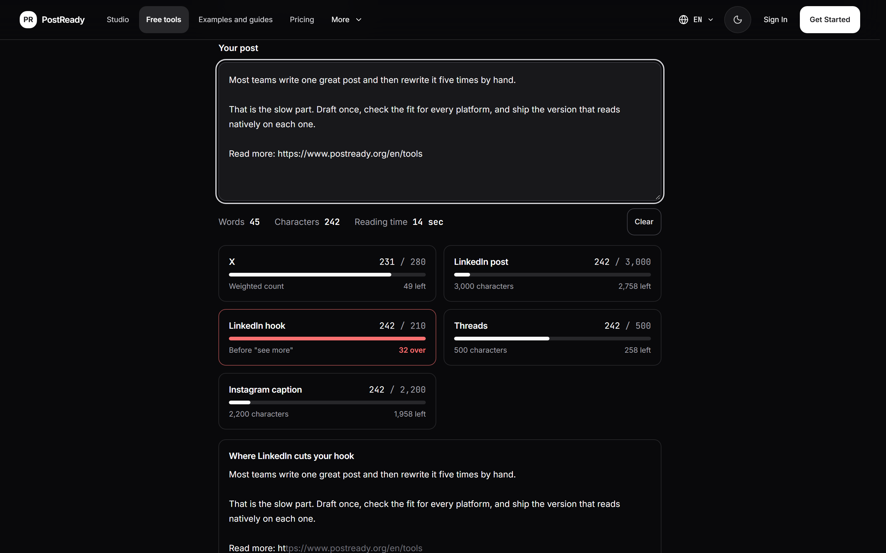
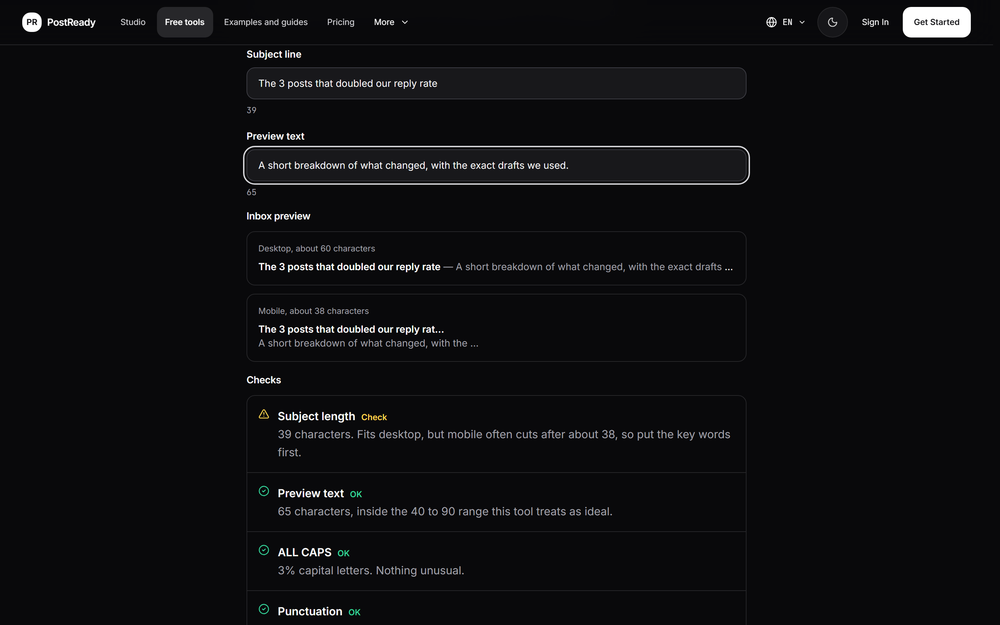
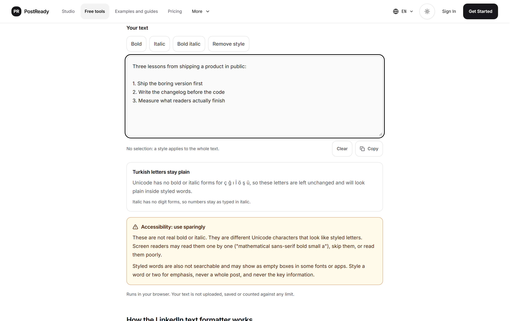
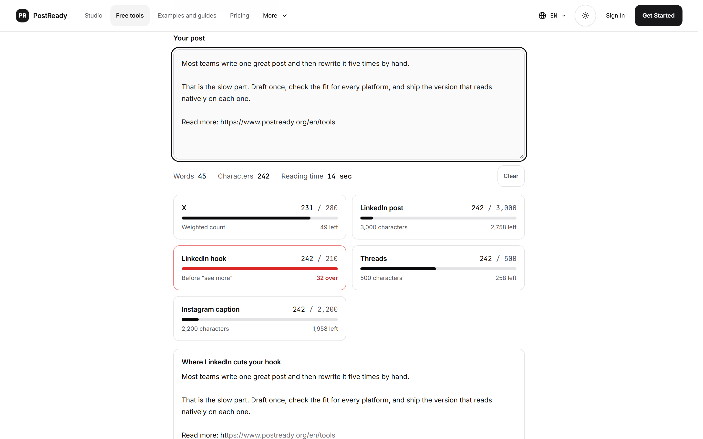
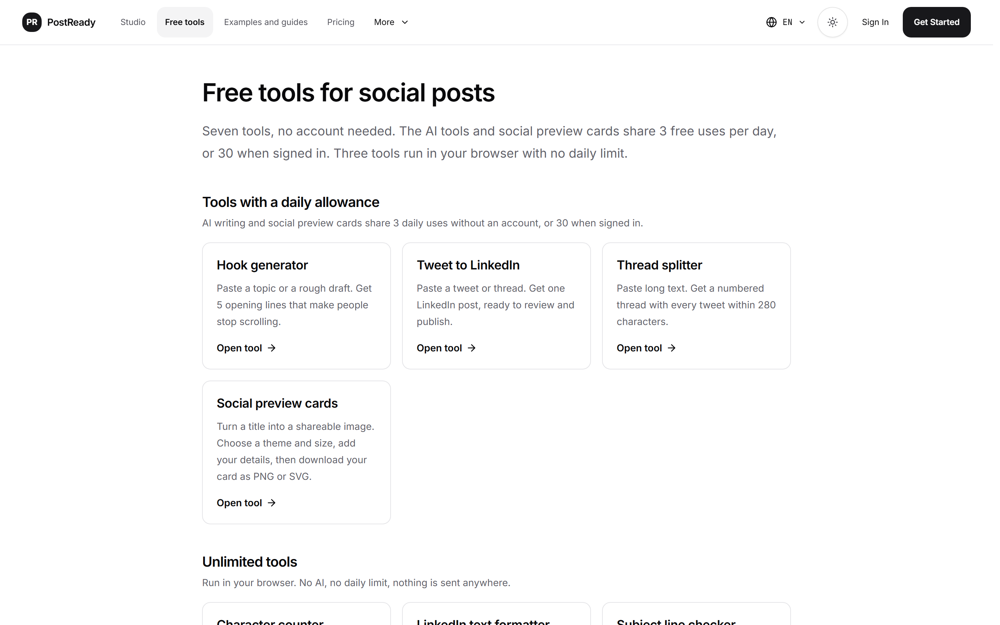
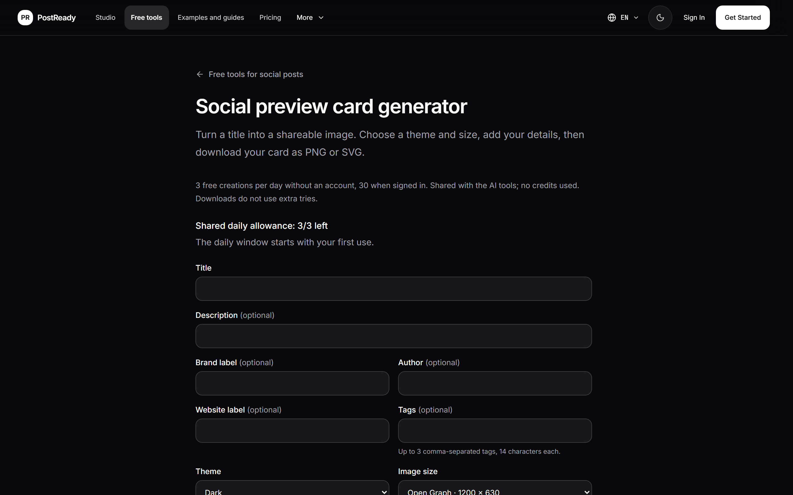
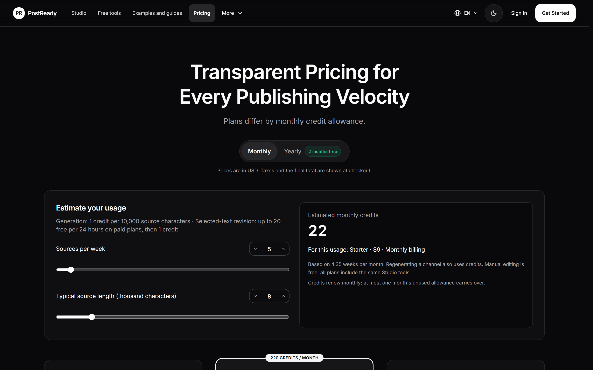
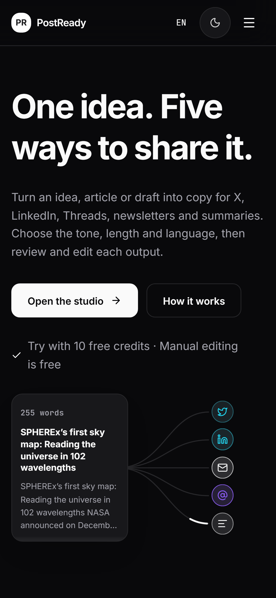
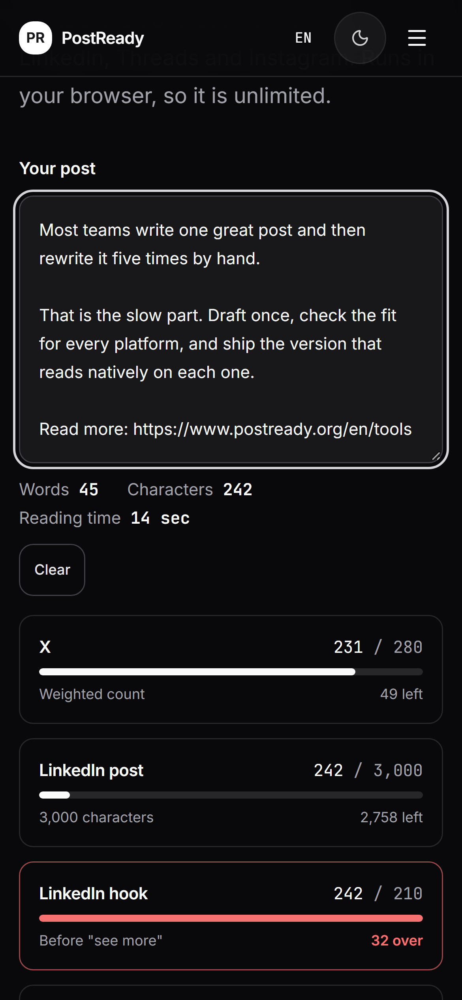

<div align="center">

<a href="https://www.postready.org/en">
  
</a>

# PostReady

**One idea. Five ways to share it.**

Turn an idea, article or draft into copy for X, LinkedIn, Threads, newsletters and summaries.<br>
Choose the tone, length and language, then review and edit each output before you publish.

[**Open PostReady →**](https://www.postready.org/en) &nbsp;·&nbsp;
[Free tools](https://www.postready.org/en/tools) &nbsp;·&nbsp;
[Pricing](https://www.postready.org/en/pricing) &nbsp;·&nbsp;
[Design language](DESIGN.md)

[](https://github.com/postready/PostReady/actions/workflows/test.yml)


<br>

<picture>
  <source media="(prefers-color-scheme: dark)" srcset="assets/screens/landing-dark.png">
  
</picture>

</div>

---

## What this repository is

This is the public home of PostReady on GitHub. It shows the product, its free tools and its design language, and it publishes the open part of the code: the browser-only writing tools.

The generation engine behind the PostReady studio is closed source and is **not** part of this repository. Nothing here talks to an AI provider, a database or a billing service.

| Open, in this repository | Closed, runs on postready.org |
| --- | --- |
| Screenshots and product tour | The studio and its generation engine |
| [Design language](DESIGN.md) and [CSS tokens](design/tokens.css) | Prompts, model routing and quality checks |
| [Browser-only writing tools](src/writing-tools.ts) with tests | AI tools, accounts, credits and billing |

## The studio

Paste one source (an idea, an article, a transcript or a rough draft) and get five outputs, each written for its network:

- **X**: a punchy single post, or a numbered thread where every post fits 280 characters
- **LinkedIn**: a post with a strong first line before the "see more" cut-off
- **Newsletter**: a ready-to-send issue
- **Threads**: a short, conversational caption
- **Summary**: a briefing for readers who only want the key points

Each output opens in a live preview of its platform, where you can edit inline, check the counts and copy it. The studio works in English, Turkish, Spanish, German and French. New accounts start with 10 free credits, and manual editing is always free.

## Free tools

Seven tools, no account needed. Three run entirely in your browser with no daily limit; the AI tools and preview cards share a small free daily allowance.

### Unlimited, in your browser

Open source in this repository. Nothing you type leaves your device.

| Tool | What it does |
| --- | --- |
| [Character counter](https://www.postready.org/en/tools/character-counter) | Live counts against X, LinkedIn, Threads and Instagram limits, X's weighted count (URLs count as 23, emoji as 2), the LinkedIn "see more" cut-off, words and reading time |
| [LinkedIn text formatter](https://www.postready.org/en/tools/linkedin-text-formatter) | Unicode bold, italic and bold italic for LinkedIn posts, with an accessibility note |
| [Subject line checker](https://www.postready.org/en/tools/subject-line-checker) | Length, ALL CAPS, punctuation and emoji checks for a newsletter subject and preview text, with desktop and mobile inbox previews |

<table>
  <tr>
    <td width="50%"></td>
    <td width="50%"></td>
  </tr>
  <tr>
    <td></td>
    <td></td>
  </tr>
</table>

### With a daily allowance

3 uses a day without an account, 30 when signed in.

| Tool | What it does |
| --- | --- |
| [Hook generator](https://www.postready.org/en/tools/hook-generator) | Five opening lines for a topic or rough draft |
| [Tweet to LinkedIn](https://www.postready.org/en/tools/tweet-to-linkedin) | Turns a tweet or thread into one editable LinkedIn post |
| [Thread splitter](https://www.postready.org/en/tools/thread-splitter) | Splits long text into a numbered X thread where every post fits 280 characters |
| [Social preview cards](https://www.postready.org/en/tools/social-preview) | Turns a title into a shareable image, downloadable as PNG or SVG |

<table>
  <tr>
    <td width="50%"></td>
    <td width="50%"></td>
  </tr>
</table>

## Design language

PostReady is dark-first and editorial: high contrast, Inter for reading, JetBrains Mono for counts and labels, 1px hairline borders instead of heavy shadows, and interactions that finish within 200ms. Colour carries meaning only: emerald for success and copy feedback, red for a limit you have gone over, and one platform tint per output.

Read the full system in [DESIGN.md](DESIGN.md), or use the [CSS tokens](design/tokens.css) directly.

<table>
  <tr>
    <td width="50%"></td>
    <td width="50%"></td>
  </tr>
  <tr>
    <td align="center"></td>
    <td align="center"></td>
  </tr>
</table>

## Use the open tools in your own code

[`src/writing-tools.ts`](src/writing-tools.ts) has no dependencies and makes no network calls. It is the same module that powers the three unlimited tools on postready.org.

```ts
import { platformCounts, xWeightedLength, toStyledText, analyzeSubject } from "./src/writing-tools.ts";

xWeightedLength("Read this: https://example.com/a/very/long/link 😀"); // 37: 12 characters + URL 23 + emoji 2
platformCounts(draft);            // [{ platform: "x", used, limit: 280, remaining, over }, ...]
toStyledText("Ship it", "bold");  // "𝗦𝗵𝗶𝗽 𝗶𝘁"
analyzeSubject("The 3 posts that doubled our reply rate", "A short breakdown of what changed.");
// { length: 39, desktop: { status: "good" }, mobile: { status: "warn", cutAt: 38 }, ... }
```

Run the tests with Node.js 22.18 or newer. Node runs the TypeScript directly, so there is nothing to install:

```bash
npm test
```

X does its own final count when you publish. `xWeightedLength` follows the published twitter-text v3 weighting, and the source documents where it is only an approximation.

## Links

- Website: [postready.org](https://www.postready.org/en)
- Free tools: [postready.org/en/tools](https://www.postready.org/en/tools)
- Organization: [github.com/postready](https://github.com/postready)

## License

The code in [`src/`](src/) and [`design/`](design/) is released under the [MIT License](LICENSE). The PostReady name, logo, screenshots and website copy are not covered by that license; see [NOTICE](NOTICE).
